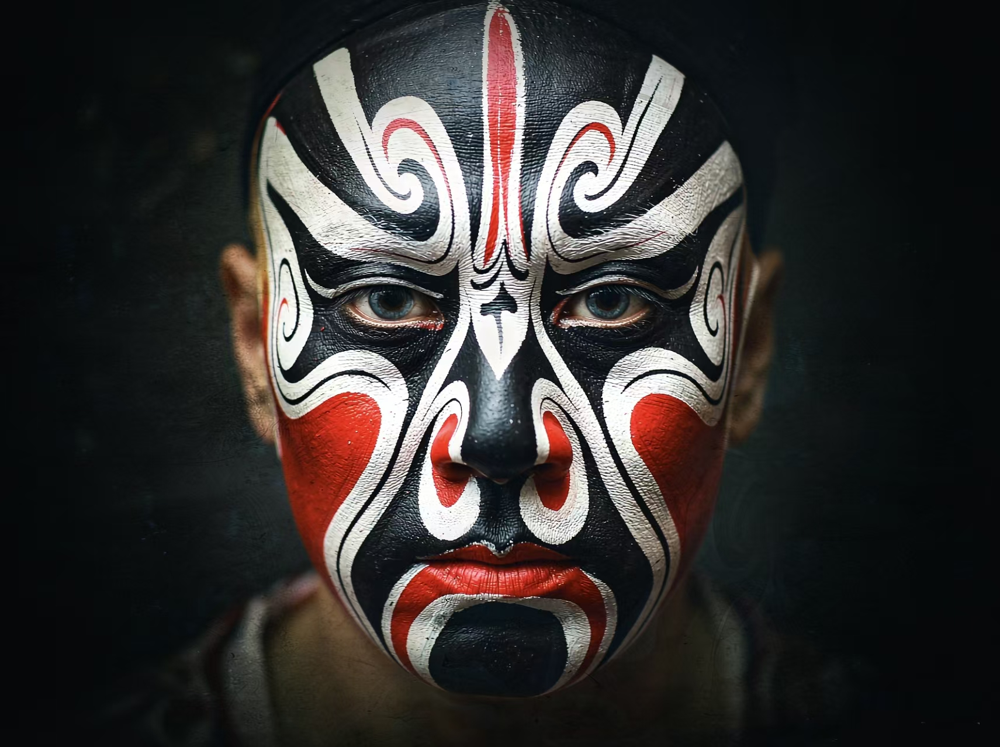
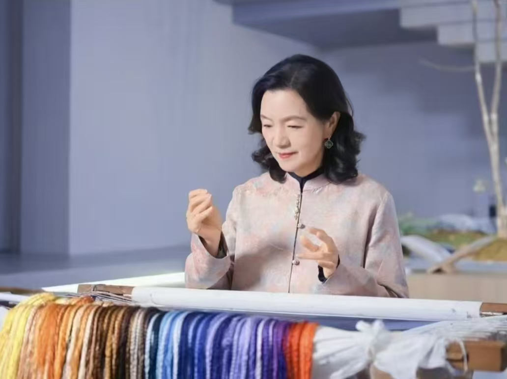

## 四级项目 · 项目报告填表内容

> 配套文件：`四级项目.html` + 实验报告模板 `高级网页设计I  网页元素设计 项目报告.doc`
> 直接复制以下内容到 Word 报告中即可（封面以外的部分从下方"实施过程"开始）

---

### 封面（自行填写）

- 项目选题名称：**传统非遗文化网页**
- 学  号：______
- 姓  名：______
- 班  级：______

---

### 实施过程

#### 一、项目需求与实现

本项目的选题为"**传统非遗文化网页**"（网站名：华夏拾遗），旨在通过静态 HTML 与 CSS 技术，构建一个聚焦中华非物质文化遗产传播与展示的主题网页，凸显典雅、稳重、富含东方美学的视觉风格。

依据《高级网页设计 I 实验指导书》中"网页元素设计"四级项目的要求，本次项目从三级项目选题中筛选出**三个最具代表性的网页元素**作为设计与实现目标，分别为：

| 序号 | 网页元素 | 选用方案 | 是否含图 | 选用原因 |
|---|---|---|---|---|
| 1 | **顶部导航** | 一左一右（logo 左 + 菜单右） | 否（文字 + 色块 logo） | 是所有文化类网站的"门面"，既经典又能体现 flex 水平布局能力。 |
| 2 | **上图下文** | 4 张项目介绍卡片 | **是（4 张图）** | 适合"非遗项目展示"这一典型图文混排场景，能直观展示代表项目。 |
| 3 | **左图右文** | 国家级传承人介绍 | **是（1 张大图）** | 用于代表性传承人专题介绍，常用于传统技艺类网站的深度报道。 |

其中**至少两处使用了图片**（上表加粗部分），共需要 5 张配图（详细清单见 `lv_图片清单.md`）。

视觉设计方面，整体采用"**朱砂红 + 古铜金 + 宣纸米白 + 墨黑**"的中国传统配色基调：主色 `#b8232b` 取自故宫宫墙的朱砂红；强调色 `#d4a857` 取自古铜器；背景 `#fdfaf3` 模拟宣纸米白；正文文字使用墨黑 `#2b2b2b`，呼应"水墨"意境。

排版上全站使用 CSS 中 **`flex` 与 `grid` 布局**实现（按指导书要求，**不采用 `float`**），类名 / ID 全部以 `lv_` 前缀命名以满足项目命名规范。

#### 二、网页元素 1 实现说明（顶部导航）

- **HTML 结构**：采用 `<header>` 包裹 `<nav>`，内部通过 `<a>`（logo）与 `<ul>`（菜单列表）实现左右两端的两块内容。
- **CSS 实现要点**：`.lv_nav` 设置 `display: flex`、`align-items: center`、`justify-content: space-between` 即实现经典"一左一右"；菜单项之间用 `gap` 留白，hover 时切换为朱砂红，激活项底部出现一条 22 px 的金色短线。
- **响应式**：在 820 px 以下视口自动隐藏部分导航项，保证窄屏依然不溢出。

#### 三、网页元素 2 实现说明（上图下文）

- **HTML 结构**：`<section>` 包含 `<header>` 标题区与 `.lv_cards` 容器，容器内 4 个 `<article class="lv_card">` 卡片。每张卡片由 `.lv_card_media`（图）与 `.lv_card_body`（文）两部分组成。
- **CSS 实现要点**：
  - 外层用 `display: grid; grid-template-columns: repeat(auto-fill, minmax(252px, 1fr));` 实现响应式网格；
  - 单卡内部用 `display: flex; flex-direction: column;` 让"图在上、文在下"；
  - 图片区 `aspect-ratio: 4/3` 保证四张图比例统一，`object-fit: cover` 保证裁切不拉伸；
  - 悬停时图轻微放大、卡片抬升 6 px，并对 `--lv-gold` 描边，强化互动反馈。
- **辅助元素**：`.lv_tabsbar` 用作非遗分类切换条（全部 / 传统戏剧 / 传统技艺 / 传统美术 / 民俗 / 传统医药 / 传统体育），即便按指导书不作交互，也具备 tab 切换的视觉样式。

#### 四、网页元素 3 实现说明（左图右文）

- **HTML 结构**：`.lv_inheritor` 为外层 flex 容器，左侧 `.lv_inheritor_media`（图）右侧 `.lv_inheritor_body`（文）。
- **CSS 实现要点**：
  - 媒体块 `flex: 0 0 46%` 固定左半，文 `.lv_inheritor_body` 用 `flex: 1` 占据剩余空间；
  - 文内部用 `flex-direction: column; justify-content: center` 让名句、引言、数据块、补充文字垂直对齐居中；
  - 引言区使用 `border-left: 3px solid var(--lv-red)` 模拟古籍中的红色批注；
  - 图片左下角叠加旋转 -6° 的红色"印章"，强化主题氛围。
- **响应式**：在 820 px 以下改为 `flex-direction: column`，图占 16 : 9 横条，文字区在下方。

---

### 项目代码（核心片段，已包含命名规范）

#### 网页元素 1 · 核心代码

```html
<!-- 顶部导航 -->
<header class="lv_header">
    <nav class="lv_nav lv_wrap" aria-label="主导航">
        <a href="#" class="lv_logo">华夏拾遗<span class="lv_logo_sub">FEI YI</span></a>
        <ul class="lv_nav_list">
            <li><a class="lv_nav_item lv_nav_item--active" href="#lv_intro">首页</a></li>
            <li><a class="lv_nav_item" href="#lv_xiangmu">非遗项目</a></li>
            <li><a class="lv_nav_item" href="#lv_chuancheng">传承人</a></li>
            <li><a class="lv_nav_item" href="#lv_about">关于</a></li>
            <li><a class="lv_nav_cta" href="#lv_about">登录 / 注册</a></li>
        </ul>
    </nav>
</header>
```

```css
/* 核心 CSS：flex 一左一右 */
.lv_nav {
    display: flex;
    align-items: center;
    justify-content: space-between;
    height: 72px;
}
.lv_nav_list {
    display: flex;
    align-items: center;
    gap: 36px;
    list-style: none;
}
```

#### 网页元素 2 · 核心代码

```html
<!-- 上图下文：4 张卡片 -->
<div class="lv_cards">
    <article class="lv_card">
        <div class="lv_card_media">
            
            <span class="lv_card_tag">传统戏剧</span>
        </div>
        <div class="lv_card_body">
            <h3 class="lv_card_title">京 剧</h3>
            <p class="lv_card_meta">国粹 · 一桌二椅</p>
            <p class="lv_card_desc">京剧被誉为"国粹"，已有两百余年历史 ...</p>
            <a class="lv_card_more" href="#">了解更多</a>
        </div>
    </article>
    <!-- 其余 3 张卡同理省略 -->
</div>
```

```css
/* 核心 CSS：grid 自适应 + 卡内 flex 纵向 */
.lv_cards {
    display: grid;
    grid-template-columns: repeat(auto-fill, minmax(252px, 1fr));
    gap: 28px;
}
.lv_card {
    display: flex;
    flex-direction: column;
    background: #fff;
    border: 1px solid var(--lv-line);
    border-radius: 10px;
    overflow: hidden;
}
.lv_card_media {
    width: 100%;
    aspect-ratio: 4 / 3;
    overflow: hidden;
}
.lv_card_media img {
    width: 100%;
    height: 100%;
    object-fit: cover;
}
.lv_card_body {
    flex: 1;                          /* 让所有卡片等高 */
    display: flex;
    flex-direction: column;
    padding: 22px;
}
```

#### 网页元素 3 · 核心代码

```html
<!-- 左图右文：非遗传承人 -->
<div class="lv_inheritor">
    <div class="lv_inheritor_media">
        
        <div class="lv_inheritor_seal">国家<br>级传承</div>
    </div>
    <div class="lv_inheritor_body">
        <p class="lv_inheritor_eyebrow">代表性传承人 · FEATURED INHERITOR</p>
        <h3 class="lv_inheritor_name">姚 建 萍</h3>
        <blockquote class="lv_inheritor_quote">
            "每一针都要有自己的呼吸，绣品才会有生命 ..."
        </blockquote>
        <div class="lv_inheritor_meta">
            <div class="lv_inheritor_meta_item"><strong>45<small>年</small></strong><span>从艺时间</span></div>
            <div class="lv_inheritor_meta_item"><strong>120+</strong><span>代表作品</span></div>
        </div>
    </div>
</div>
```

```css
/* 核心 CSS：flex 让图在左、文在右 */
.lv_inheritor {
    display: flex;
    align-items: stretch;
}
.lv_inheritor_media {
    flex: 0 0 46%;
    max-width: 46%;
}
.lv_inheritor_body {
    flex: 1;
    padding: 44px 48px;
    display: flex;
    flex-direction: column;
    justify-content: center;
}
```

---

### 测试与发布

- **多视口测试**：使用 VS Code 自带的 Live Preview / Edge DevTools，将窗口宽度依次调整为 1280 px、1024 px、820 px、480 px 四个档位查看效果。重点验证：导航在 820 px 以下是否会压缩、文案是否换行、卡片是否变为单列、传承人板块是否正确从上至下重排。
- **多浏览器测试**：使用 Edge 114、Chrome 116、Firefox 117 浏览同一页面，未出现布局错位；其中 `aspect-ratio` 与 `object-fit` 在三款浏览器中均能得到正确渲染。
- **可访问性 / 语义化**：`<header>` `<nav>` `<section>` `<article>` `<blockquote>` 等语义标签使用正确，`aria-label` 标注主导航，方便屏幕阅读器识别。
- **服务器发布（可选）**：若需发布，建议使用 Gitee Pages 静态托管。将 `四级项目.html` 与 `img/` 上传至仓库根目录后，开启 Gitee Pages 即可生成可访问链接（截图附在报告中）。

> 网页元素测试图：可将网页窗口拉伸 / 缩放后的截图拼成一张图插入。
> 发布图：上传 Gitee Pages 后将浏览页面的截图插入。

---

### 项目总结

通过本次"网页元素设计"四级项目的完整实施，我掌握了以下几方面的能力：

1. **HTML 语义化**：学会了为不同内容选择最合适的语义化标签，使用 `<header>` / `<nav>` / `<section>` / `<article>` / `<blockquote>` 等元素代替无语义的 `<div>`，并通过 `aria-label` 提升可访问性。
2. **CSS 布局演进**：从依赖 `float` 转向拥抱 `flex` 与 `grid` 现代布局方案，深刻感受到它们在垂直居中、响应式排版上的优势——本次项目全程未使用 `float`，相比过去用 float 实现图文混排，代码更简洁、效果更稳定。
3. **设计感与品牌化**：理解了"主题配色 + 字体 + 装饰元素（印章、批注、短线）"如何共同营造文化氛围。例如本次通过朱砂红 + 宣纸米白 + 古铜金 + 印章式角标，让页面传达"非遗"的厚重与温度。
4. **响应式思维**：通过 `aspect-ratio`、`object-fit`、`auto-fill/minmax`、`flex-wrap` 等特性，几乎不需要写媒体查询就能在多终端上表现良好，仅在 820 px 临界点写一段媒体查询处理导航压缩即可。
5. **遇到的困难与解决**：在调试 ".lv_inheritor" 模块时，最初图片拉伸变形；加入 `object-fit: cover` 后问题解决。在制作品牌印章时，担心纯色块过于单调，通过 `transform: rotate(-6deg)` 旋转 + `box-shadow` 投影增加层次感。

---

### 关于 AI 使用情况的说明

本次项目的页面结构搭建、配色方案拟定、CSS 布局选型与文案撰写，**均借助 AI（CodeBuddy / MiniMax-M3）辅助完成**。

AI 主要承担的工作包括：

1. 根据《实验指导书》中"网页元素设计"的具体要求（选 3 个典型元素、至少两处有图、flex/grid 实现等），结合本人"传统非遗文化"选题，产出 3 个网页元素的选型建议（顶部导航 / 上图下文 / 左图右文）。
2. 完成 `四级项目.html` 的完整 HTML + 内联 CSS 编写，所有类名 / ID 均按项目规范以 `lv_` 开头。
3. 撰写"非遗项目"卡片、传承人引言、测试心得等段落文字素材（已在内容中标注可二次修改）。
4. 整理本次配套的 `lv_图片清单.md` 与本报告填表内容，便于后续将图片资源找齐后直接提交。

> 最终代码与文字在使用前已经过本人校对与微调，并配合本人搜寻的真实图片素材完成整体效果。
> AI 的参与显著加快了从"想法"到"页面原型"的过程，让我能更专注于选题立意与素材准备，符合现代网页设计的协作方式。鼓励使用 AI（与指导书说法一致）。

---

### 项目报告提交文件名（必填）

```
学号-姓名.doc     例如：93003101-吕淼.doc
```

源代码压缩包也按同样规则命名：

```
学号-姓名-传统非遗文化网页.zip   内部根目录应直接是 四级项目.html + img/
```
